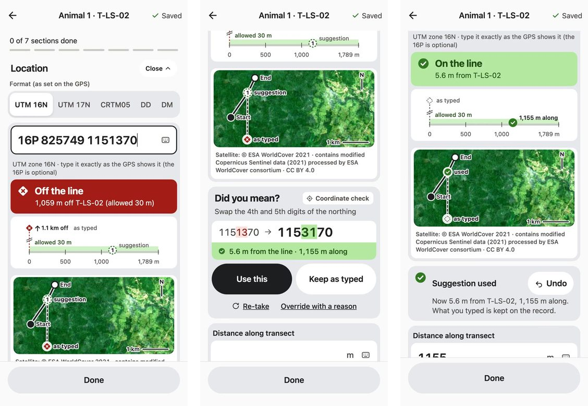
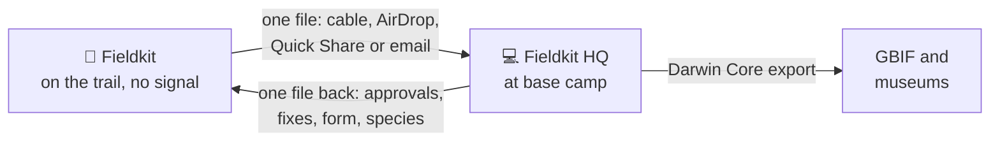
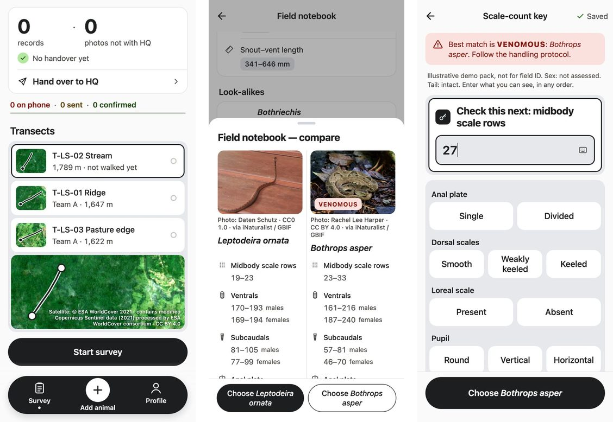
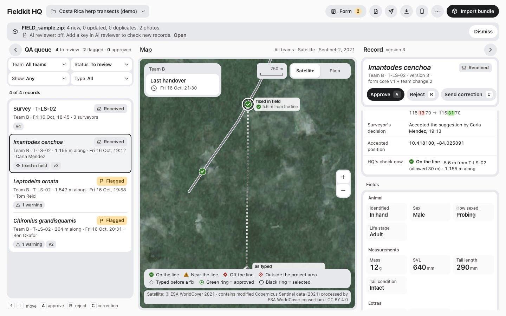

# Fieldkit

**Offline data collection for wildlife surveys, for teams that spend weeks without signal.** A phone app for the
trail (**Fieldkit**) and a laptop app for base camp (**Fieldkit HQ**). They never need a server or WiFi to work
together.

Built by team **get-offline** at **Science Works: Reinvent the Wheel**, a tools-for-science hackathon at Pillar VC,
King's Cross, London, 16–18 October 2026. Everything in this repository was written during the event.

> **Status:** finished for the demo on Sunday 18 October. Both apps work end to end on the demo data (phone → file →
> laptop → file → phone), and **140 automated tests pass** (shared 51, phone 56, laptop 33).



*Real screens from the running app, on demo data. A slipped digit puts the point 1 km into the forest. Fieldkit
catches it as it's typed, offers the one-digit fix, and keeps what was typed on the record.*

## The problem

We built this with a field researcher who studies snakes and frogs in southern Mexico. Each season the team spends
six weeks in the forest with WiFi once or twice a week. At night they walk set routes (transects) and record every
animal they find. Today that means a form app called Epicollect5, and a lot of paper:

- **The form can't change without internet**, and a form update can wipe records that haven't been sent yet.
- **One slipped GPS digit makes a point unusable.** Nobody notices until someone types up the sheet days later.
- **A student scribe writes down the species name**, and often mishears or misspells it.
- **A wet or smudged sheet is simply lost.**
- **Typing up takes about two hours every evening**, roughly 80 hours a season.

## How it works



The phone works on the trail, the laptop works at camp, and the data travels between them as a **bundle file**: a
zip of records and photos with a checksum on every file. There's no server, so nothing depends on WiFi.

**Strict on purpose:**
- Every tap saves instantly, and nothing is ever deleted (records are append-only, with full history).
- A point more than 30 m off the route gets flagged.
- The form can change; old records never do (each record keeps its form version).
- The AI suggests; a person decides.

## What it does

### Fieldkit (the phone app, `field/`)



- **Works in airplane mode, all week.** Routes on a satellite picture; the demo project loads offline.
- **Every record saved on every tap** ("✓ Saved"), and still there after a force-close.
- **Typed GPS checked against the route** as it's typed: On the line · Near the line · Off the line · Outside the
  project area. A one-digit **"Did you mean?"** fix; the distance along the route fills in by itself. Reads UTM
  16N/17N, CRTM05, decimal degrees, degrees-minutes and Garmin "16P …" readings.
- **Forgiving species search:** "leptodira" finds *Leptodeira ornata*, with a "Close match" note and its photo.
- **A field guide in the app, offline:** the species notebook, and **compare look-alikes** side by side
  (*Leptodeira* vs the venomous *Bothrops asper*).
- **Scale-count key:** enter what you can see, in any order (27 midbody rows → *Bothrops asper*, **VENOMOUS**).
- **The Team Lead changes the form offline** (e.g. adds "Number of individuals"); records already made don't change.
- **Survey start:** weather in two taps, sun and moon times filled in automatically, night-survey extras. Protocol
  warnings warn, never block.
- **Hand-over as one file**, by cable, AirDrop, Quick Share or email, with a status on every record (On phone · Sent
  · HQ ✓).
- **Receive from HQ:** new form versions, approved fixes (a corrections inbox to accept or decline), the species
  pack, satellite pictures and species photos.
- Also: night mode for head-torch work, photos with every record, a shared phone with a profile per person, a
  storage ring and a storage check that refuses deletes, and "add a species not in the pack" (provisional until HQ
  approves it).

### Fieldkit HQ (the laptop app, `hq/`)



- **Imports files from every phone** without duplicates or losses. Re-sending is harmless; a damaged file is named
  and skipped, and everything else still imports.
- **Every team on one satellite map**, with each fixed point on its route and a dashed line back to what was typed.
- **A review queue:** filters, then approve, reject or send a correction (keys **A**, **R**, **C**). Each flag says
  why ("above this pack's maximum", "out of walking order").
- **Record history:** every version and what changed.
- **AI reviewer:** drafts fixes and notes for a person to approve (e.g. SVL 4,350 mm → 435 mm). See below.
- **Check a list of points:** paste an old paper sheet's coordinates; the odd one out goes red with its fix.
- **Form control:** accept a team's change into the next form version and publish it.
- **Makes a file for each team** (approvals, corrections, form, satellite picture, species photos).
- **Provisional species:** "Did you mean …?" maps a name from the field onto the species pack.
- **Darwin Core export** for GBIF (approved records only).
- Also: several projects on one laptop, a devices panel, a satellite/plain map switch, and it installs as an
  offline web app.

### The AI reviewer

The AI is **Claude Opus 5.5** (`claude-opus-5-5`, from Anthropic), and it runs **on the laptop only**. It
reviews the week's records using **our own checks as tools**: `check_coordinate`, `check_ranges`,
`batch_check_transect`, `check_point_set`, `search_taxa` and `run_key`. Then it drafts corrections, adds notes and
writes a summary for each team.

- **It never changes data on its own.** Every draft waits for a person to approve it.
- **Your API key stays in your browser.** It's never in a file, a bundle or a commit.
- **Without a key, everything else still works.**

## What's in the repo

```
shared/      The rulebook both apps use: data types, the bundle format and its checks, the coordinate
             checker, species search, the scale-count key, range checks, sun and moon times.
             Pure TypeScript, tested.
  fixtures/  Sample bundles (FIELD_sample.zip, HQ_sample.zip) both apps test against.
demo-data/   The demo project: Costa Rica (La Selva) routes, form, species pack, species photos,
             satellite picture and their credits.
field/       Fieldkit, the phone app (Expo / React Native).
hq/          Fieldkit HQ, the laptop app (React + Vite).
docs/        Screenshots for this README.
```

**Built with:**
- **Phone:** Expo SDK 57, React Native, SQLite on the phone, react-native-svg for the maps.
- **Laptop:** React, Vite, MapLibre, IndexedDB (Dexie), installable as an offline web app.
- **Shared rulebook:** TypeScript, zod, proj4, turf and suncalc.
- **AI:** Claude Opus 5.5 through the Anthropic SDK.
- **Open data:** GBIF, iNaturalist and ESA WorldCover.
- **Coding assistant:** we built it with Claude Code.

## Run it yourself

You need **Node 20 or newer** (we use 24) and npm. For the phone app you also need a phone with **Expo Go**
(free, from the App Store or Google Play).

### 1. Get the code

```bash
git clone https://github.com/murtonj2003/sciworks-fieldkit.git
cd sciworks-fieldkit
npm install
```

### 2. Fieldkit HQ (laptop)

```bash
npm run dev -w @sciworks/hq
```

Open the address it prints (usually http://localhost:5173). Then:

1. Click **Load demo project**.
2. Under **More**, choose **Import sample Field bundle**, or drag any `FIELD_*.zip` onto the window. The records
   appear in the queue and on the map, with their checks.
3. Approve or reject records. Export **Darwin Core** (approved records only), or **Make bundle for a team** to send
   results back to the phones.
4. Try **More → Check a list of points**: paste lines of `label, lat, lon`.
5. *Optional, the AI reviewer:* open **AI reviewer** and paste your own Anthropic API key. It's kept only in that
   browser. The reviewer only drafts fixes, and you approve each one.

### 3. Fieldkit (phone), in Expo Go

```bash
cd field
npx expo start
```

Scan the QR code: with the Camera app on an iPhone, or from inside Expo Go on Android. If your WiFi blocks
phone-to-laptop traffic (venue and office WiFi often does), use `npx expo start --tunnel` instead.

In the app:
1. Tap **Load demo project**. This works offline.
2. Choose who is using the phone: **Ben Okafor · Team Lead**.
3. Tap **Start survey**, then **+ Add animal**.
4. Under **Location**, type `16P 825749 1151370` (UTM 16N). It lands about 1 km off the route, and **Did you
   mean?** offers the swapped-digit fix. Tap **Use this**: it's 5.6 m from the line.
5. Under species, type `leptodira`. Or open **Scale key** and type `27` for midbody rows.

### 4. Fully offline on a phone

Expo Go normally loads the app from your laptop, so it needs a connection. For a real airplane-mode test:

- **Android:** build and install the app.

  ```bash
  cd field
  npx eas-cli@latest login
  npx eas-cli@latest build -p android --profile preview
  ```

  Open the link it prints on the phone to install it. The EAS project in `field/app.json` belongs to the team's
  Expo account. To build under your own, remove `owner` and `extra.eas.projectId` from `field/app.json`, then run
  `npx eas-cli@latest init` first.
- **iPhone (our stage phone):** we publish an update that Expo Go can open and keep offline. Setting
  `EXPO_GO_PREVIEW=1` (see `field/app.config.js`) gives the update Expo Go's runtime, and normal builds are
  unchanged. Open it once on WiFi; after that it opens in airplane mode, even after a force-close.

### 5. Hand data between the two

- **On the phone:** **Hand over to HQ** makes the file and opens the share sheet: AirDrop, Quick Share, a USB cable
  or email.
- **On HQ:** drag the file onto the window. Re-importing the same file never makes duplicates.
- **Back to the phone:** on HQ, **Make bundle for a team**; then on the phone, **Receive from HQ**.

### 6. Run the tests

```bash
npm test -w shared
npm test -w field
npm test -w @sciworks/hq
```

To rebuild the demo data and the sample bundles: `npm run demo-data -w shared && npm run fixtures -w shared`.

## Not built yet (next)

Cloud sync, importing Garmin GPX files, identifying species from photos, blurring the locations of rare species, and
walking a pond outline point by point on the phone.

## Data, credits and licences

- **Code:** MIT (see `LICENSE`).
- **App icon and design renders:** made by the team with OpenArt (AI image generation) during the hackathon.
- **Screenshots** (`docs/`): the real apps running on the demo data below.
- **Demo species pack:** an *illustrative demo pack, not for field ID*. It was built from cited open sources
  under CC BY 4.0; see `demo-data/attribution.md`. Every value keeps its source, licence and the source's
  own wording. The routes are synthetic demo lines, not real trails.
- **Quoted source wording:** each value in the pack keeps a short quote from its source (under 100 characters) for
  citation only. Those quotes stay under their sources' own terms and are not relicensed by the pack's CC BY 4.0.
- **Species photos:** one small copy per species (18 of 19) in `demo-data/species-photos/`. They're CC BY 4.0 or CC0
  only, each licence confirmed against GBIF's own record, and each credited in `index.json` and `attribution.md`.
  They're remade with `demo-data/species-photos/make-species-photos.py`.
- **Satellite picture** (`demo-data/basemaps/`): ESA WorldCover 2021 Sentinel-2 composite, 10 m, **CC BY 4.0**.
  © ESA WorldCover 2021; contains modified Copernicus Sentinel data (2021) processed by the ESA WorldCover
  consortium. It's remade with `demo-data/basemaps/make-basemap.py`, and
  both apps show the credit whenever the picture is on screen.
- **Dependencies:** all open-source under permissive licences (MIT, ISC, Apache-2.0, BSD and similar), checked
  17 Oct 2026. `lightningcss` (MPL-2.0) is only a build tool inside Expo and is not shipped in the app.
- **Exports** follow Darwin Core (Event + Occurrence + MeasurementOrFact, with Humboldt survey-effort fields).
